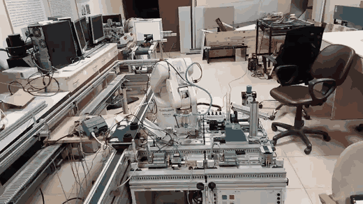
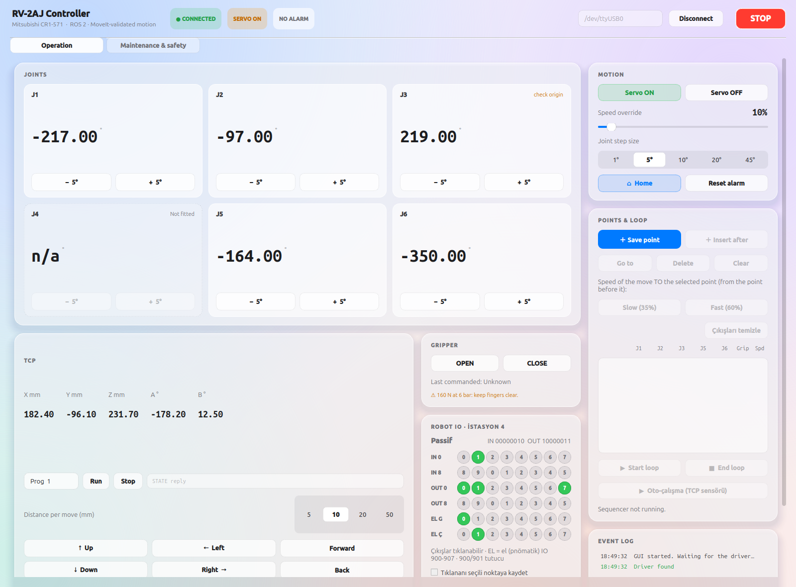

# RV-2AJ Robot Cell — Complete Project Documentation

Control software for a **Mitsubishi MELFA RV-2AJ** robot arm (controller **CR1-571**) standing on
**Station 4 of a Festo MPS 500 transfer line**, with a PyQt control panel, a ROS 2 + MoveIt motion
stack, and a link to the conveyor's new Siemens S7-1200 PLC.

This document describes everything in the project: the hardware and how it is wired, the serial
protocol and every command that was verified on the real controller, the calibration of this
particular robot, every ROS node, topic, service and parameter, the transfer-line and PLC integration, all tools and tests,
day-to-day operation, troubleshooting, safety rules, known issues and the project history.

> Last updated: 2026-10-28. (See [§16 Project history](#16-project-history): the Maintenance & safety tab (§8.2),
> the conveyor PLC link (§9.1) and the move to ROS 2 Lyrical.)

---

## Screenshots & demos

**The real RV-2AJ running the 44-point assembly** on Station 4 of the Festo MPS 500 line — the
full taught sequence (per-point speeds and gripper/I/O actions) executed by the robot over RS-232
(sped up ~19×; the full video runs about 4.5 minutes):



**The operator control panel** (`gui_node.py`, started with `./start_robot.sh`) — live joints,
TCP pose, Motion (servo / speed / joint step / home), Points & Loop with the per-point
**Slow/Fast** speed buttons, the Gripper card, the full **Station I/O** panel (IN/OUT groups
including the pneumatics); a second tab holds Maintenance & safety (§8.2).



> More images (the live robot and cell, loops running) are best captured on
> the hardware — drop them in `docs/images/` and reference them here.

---

## Contents

1. [Quick start](#1-quick-start)
2. [The hardware](#2-the-hardware)
3. [Repository layout](#3-repository-layout)
4. [Serial protocol and verified commands](#4-serial-protocol-and-verified-commands)
5. [Calibration of this robot](#5-calibration-of-this-robot)
6. [ROS 2 stack (rv2aj_ws)](#6-ros-2-stack-rv2aj_ws)
7. [Motion: how a move is planned and executed](#7-motion-how-a-move-is-planned-and-executed)
8. [The control panel (GUI)](#8-the-control-panel-gui)
9. [Festo MPS 500 transfer line](#9-festo-mps-500-transfer-line)
10. [Tools, scripts and tests](#10-tools-scripts-and-tests)
11. [Offline operation, memory and performance](#11-offline-operation-memory-and-performance)
12. [Files the system writes](#12-files-the-system-writes)
13. [Troubleshooting](#13-troubleshooting)
14. [Safety](#14-safety)
15. [Known issues and open items](#15-known-issues-and-open-items)
16. [Project history](#16-project-history)

---

## 1. Quick start

### First time on a new machine

```bash
git clone git@github.com:reis0x01/RV-2AJ.git ~/Desktop/RV-2AJ
cd ~/Desktop/RV-2AJ/rv2aj_ws
source /opt/ros/lyrical/setup.bash        # or jazzy
colcon build && source install/setup.bash
cd src/rv2aj_control && python3 -m pytest -q test/     # should all pass
```

Needs ROS 2 (Lyrical or Jazzy) with MoveIt 2, xacro and robot_state_publisher, plus `python3-pyqt5`,
`python3-scipy`, `python3-serial` and (for the conveyor link) `python-snap7`. Teach points are not in the
repository: they live in `~/.ros/rv2aj_points.json`; copy one from `points_backups/` to start with the taught set.

### Start

```bash
cd ~/Desktop/RV-2AJ
./start_robot.sh               # real robot
```

| Command | What it starts |
|---|---|
| `./start_robot.sh` | real robot on `/dev/ttyUSB0` |
| `./start_robot.sh sim` | simulated controller, no robot needed |
| `./start_robot.sh real /dev/ttyUSB1` | real robot on another serial port |

The window opens after about 15–20 s. The terminal may be closed afterwards: the stack runs in its
own systemd scope (`rv2aj-stack`) and survives the terminal or VS Code closing.

`start_robot.sh` also:
- refuses to start in real mode if the serial port does not exist ("plug in the USB-serial adapter");
- refuses if the stack is already running;
- uses whichever ROS 2 is installed (`/opt/ros/lyrical`, else `/opt/ros/jazzy`);
- waits until systemd has fully released a previous `rv2aj-stack` scope before starting.

### Stop

```bash
./stop_robot.sh
```

Takes about 5 s. It sends SIGINT first (so the driver can send STOP, SRVOFF, CNTLOFF to the
controller), force-closes leftovers (the GUI ignores the normal stop signal), and
waits until the scope is really gone so `start_robot.sh` works immediately afterwards.

### First steps after starting

1. The header shows **CONNECTED** and **NO ALARM**.
2. Press **Servo ON** (only a person can do this — no code ever switches the servo on).
3. Move the robot: jog buttons, **Home**, points, the TCP arrow buttons.
4. Stop at any time: **`+`**, **Esc**, the red **STOP** button, or the hardware E-stop.

### After an alarm

Press **Reset alarm**. The driver then switches the servo off and on again automatically — on this
robot the first move after an alarm reset fails otherwise.

### Logs

- Stack log: `~/.ros/rv2aj_stack.log`

---

## 2. The hardware

### 2.1 Robot arm — Mitsubishi MELFA RV-2AJ

- 5-axis vertical articulated arm. Joints: **J1** base/waist rotation, **J2** shoulder, **J3** elbow,
  **J5** wrist pitch (tilt), **J6** wrist roll. **There is no J4** (the controller reports it as `****`).
  With 5 axes the tool can pitch and roll but cannot yaw sideways, so some orientations are impossible.
- Geometry (manual BFP-A8050, Fig. 2-5; confirmed against the controller's own positions to < 0.05 mm):
  - shoulder (J2) axis **300 mm** above the mounting face,
  - upper arm **250 mm**, forearm **160 mm**,
  - J5 axis to flange face **72 mm**, no lateral offsets.
- Catalogue values (not verified on this unit): 2 kg payload, ~410 mm reach, ±0.02 mm repeatability, ~17 kg.
- AC servo motors, absolute encoders backed by batteries. If the batteries run low the origin is lost
  (controller error 5150 "The origin has not been set", every EXEC command is then refused).
- The base is mounted turned 180° relative to the manual's drawing: at home the arm reaches away
  from the cable connectors. The URDF base mesh has a 180° yaw for this.

### 2.2 Controller — CR1-571

- Language MELFA-BASIC IV. Commands can be executed directly over the RS-232 port ("EXEC" commands).
- Its own joint limits (parameter **MEJAR**, set on the teach pendant) are the final authority; they
  are not readable over serial. The operator has widened them.
- Standard I/O on the 50-pin CN100 connector (card RZ386/RZ387). Outputs need an external 12/24 V supply.
  Factory-dedicated signals: OUT0 running, OUT1 servo on, OUT2 error, OUT3 operation rights;
  IN0 STOP (fixed), IN1 servo off, IN2 error reset, IN3 start, IN4 servo on, IN5 operation rights.

### 2.3 Gripper — Festo HGP-16

- Pneumatic parallel gripper, up to 160 N at 6 bar. Air hoses run around the wrist (watch them
  when J6 turns a lot).
- Commanded with the controller's hand commands `EXECHOPEN 1` / `EXECHCLOSE 1` (accepted with QoK;
  physical jaw motion was observed by the operator). 

### 2.4 The cell

- The robot stands on the Station 4 table of a **Festo MPS 500** transfer line ("Robot with assembly").
- Around the base: a blue block in front, a chute and pneumatic parts on the right, conveyor rails
  around the back. **These stick up above the table surface and are not in the collision model**
  (only the flat table is) — keep watching moves near them.
- The station is connected with a 24-pin SysLink cable at connector **XPA4** (see section 9).

### 2.5 PC and link

- Laptop: Ryzen 5 6600, **RTX 3050 Laptop 4 GB**, **7 GB RAM** (VS Code alone uses ~3 GB), Ubuntu 24.04, ROS 2 Jazzy.
- Serial: **FTDI FT232 USB-serial adapter** → `/dev/ttyUSB0`, **9600 baud, 8 data bits, even parity, 2 stop bits (8E2)**.
  The user must be in the `dialout` group (they are).
- The adapter has dropped off the bus a few times; the very first open after plugging it in once
  returned ~40 KB of garbage (the next open was clean).

---

## 3. Repository layout

```
~/Desktop/RV-2AJ/
├── README.md                  this file
├── start_robot.sh             start everything (see 1.)
├── stop_robot.sh              stop everything
├── rv2aj_ws/                  ROS 2 workspace (the main system)
│   └── src/
│       ├── rv2aj_description/     URDF/xacro, meshes, config/joint_limits.yaml (limits, calibration)
│       ├── rv2aj_moveit_config/   MoveIt config: SRDF (home, collisions), moveit.launch.py
│       ├── rv2aj_interfaces/      custom messages, services, actions
│       └── rv2aj_control/         all nodes, config, tests
│           ├── rv2aj_control/     Python package (nodes + libraries)
│           ├── config/            rv2aj.yaml
│           ├── launch/            bringup.launch.py
│           └── test/              pytest tests, fake PLC, joint-limit probe
├── plc/LineControl.scl        S7-1200 program: 3 stopper stations + robot handshake (§9.1)
├── docu/                      write-ups (S7-1200 retrofit, robot control methods)
├── docs/images/               screenshots and demo GIFs
├── rules.md                   standing rules
└── points_backups/            exported teach-point backups (joints, speeds, gripper, I/O)
```

> Note: build artifacts (`rv2aj_ws/build|install|log`) are regenerated by `colcon build` and are gitignored.

Outside the project:
- `~/.ros/` — runtime files (points, logs; section 12).
- `~/Documents/RV-2AJ-backups/` — full project backups.

---

## 4. Serial protocol and verified commands

### 4.1 Framing

- Every command is sent as `1;1;<COMMAND>\r`.
- Replies end with `\r`. A reply starting with **`Qo`** means OK, **`Qe`** / **`Qx`** means error.
- A **lowercase** status letter (`Qok`, `Qer`) means an alarm is pending; `RSTALRM` clears it.
- Error replies encode the error number: `QeR422000000` → error 4220. `ERRORMES<n>` returns its text.

### 4.2 Read-only queries (used by the poll loop)

| Command | Reply example | Meaning |
|---|---|---|
| `STATE` | `QoK1.MB4;10;100;4;01060;1;1;;;;;;;;;REP;START;1;0` | program, line, **override %**, …, **last error field** |
| `JPOSF` | `QoKJ1;-149.72;J2;-64.62;J3;137.13;J4;****;J5;-92.73;J6;-72.67;...` | joint angles (J4 `****`) |
| `PPOSF` | `QoKX;84.78;Y;49.46;Z;522.81;A;-221.18;B;-20.22;...` | tool position in the controller's frame |
| `VALM_INB(0)` / `VALM_OUTB(0)` | `QoKM_INB=+16` | I/O byte 0 (bits 0–7) |
| `VALM_IN(n)` / `VALM_OUT(n)` | `QoKM_OUT(4)=+0` | single input/output |
| `VALM_ERR`, `VALM_ERRNO`, `VALM_ERRLVL` | `QoKM_ERRNO=+0` | active error state |
| `VALJTMP`, `VALPTMP` | `QoKJTMP=(-156.60,-6.49,+145.55,+0.00,-34.60,+61.33)` | read back a variable |
| `ERRORMES<n>` | `QoKEncoder communication error` | error text |

**Important — reading `STATE`:** its 5th field (`01060`, `A1060`, `81062000`…) contains the **last
recorded** error, not necessarily an active one. An active joint-range alarm appears as
**`81069x`** where **x is the axis** (`8106961` = J1, `…62` J2, `…63` J3, `…65` J5). Use
`VALM_ERR` / `VALM_ERRNO` to know whether an error is active. (Misreading this once led to a
wrong "J5 encoder fault" diagnosis — see section 16.)

### 4.3 State-changing commands (verified)

| Purpose | Commands |
|---|---|
| Operation rights | `CNTLON` / `CNTLOFF` (needed before EXEC commands; otherwise error 6020 "The Operation is disable") |
| Servo | `SRVON` / `SRVOFF` |
| Stop | `STOP` (halts an EXECMOV mid-move) |
| Reset alarm | `RSTALRM` |
| Speed override | `EXECJOVRD <1-100>` (needs CNTLON) |
| **Relative joint move** | `EXECJTMP=J_CURR`, `EXECJTMP.J<n>=JTMP.J<n>+RAD(<deg>)`, `VALJTMP` (check), `EXECMOV JTMP` |
| **Absolute joint move** | same as above, one `+RAD(target-current)` edit per joint (see below) |
| **Straight TCP move** | `EXECPTMP=P_CURR`, `EXECPTMP.Z=PTMP.Z+5.00`, `VALPTMP`, `EXECMOV PTMP` |
| Gripper | `EXECHOPEN 1` / `EXECHCLOSE 1` |
| Outputs | `EXECM_OUT(n)=0/1` (after CNTLON; read back to confirm) |
| Continuous path | `EXECCNT 1` / `EXECCNT 0` (accepted) |

Behaviour notes:
- `EXECMOV` replies `QoK` immediately; the motion continues afterwards, so the driver polls `JPOSF` until settled.
- **A new EXECMOV while a move is running is refused**: error **5640 "Cannot execute during RUN"** — with or
  without `CNT 1`. Moves sent over serial cannot be blended; every move stops before the next one.
- Tuple expressions are **not** accepted: `J_CURR+(...)` gives **L4220 syntax error**. The absolute tuple form
  `JTMP=(j1,...,j6)` was never confirmed, so absolute moves are built only from the verified component edits.
  The simulator rejects any tuple form so this can never creep back in.
- Every move is read back with `VAL…` and checked before `EXECMOV`; a mismatch refuses the move.
- `OPEN` always returns `QeR601` but is harmless.

### 4.4 Error numbers seen on this robot

| Error | Text | Meaning here |
|---|---|---|
| 0965 | Excessive error 1 | servo could not follow |
| 1060 / 1069 | Encoder communication error | appeared as the stale "last error" in STATE |
| 1120 | Encoder ABS position data lost | origin data lost (batteries) |
| 4220 | Syntax error | e.g. `J_CURR+(...)` |
| 5150 | The origin has not been set | origin lost — all EXEC commands refused |
| 5600 | Cannot execute during an error | reset the alarm first |
| 5640 | Cannot execute during RUN | a move is still running |
| 6010 | Illegal command | |
| 6020 | The Operation is disable | CNTLON missing |
| `81069x` in STATE | joint range limit on axis x | controller limit (MEJAR) reached |

### 4.5 Robot quirk

After any alarm reset, **the next move fails** unless the servo is switched **off and on** again.
The driver's `reset_alarm` does this automatically; the limit probe does it too.

---

## 5. Calibration of this robot

All robot-specific numbers live in **one file**:
`rv2aj_ws/src/rv2aj_description/config/joint_limits.yaml`. It is read by the URDF (MoveIt),
the kinematics library (planner, driver) and the GUI. After editing it, rebuild
(`colcon build --packages-select rv2aj_description rv2aj_control`) and restart.

### 5.1 Origin and zero offsets

On 2026-09-28 the operator re-set the controller's origin. The new zeros are **not** the real
"arm straight up" pose, so the controller's own X/Y/Z (and our model, which agreed with it)
was wrong: a "horizontal" circle came out vertical.

Fix (software calibration, the operator's choice): the arm was jogged **straight up** (upper arm,
forearm and wrist in one vertical line) and the readings were stored:

```yaml
zero_offsets_deg: {J2: -90.3, J3: 66.16, J5: -173.11}
```

Everything geometric uses `reading − offset`:
- `kinematics.fk()` / `ik()` (planner, driver, GUI, simulator),
- the URDF joint origins (turned by −offset, so MoveIt's model and the table check match reality),
- the tool position shown in the GUI (computed from the corrected model instead of the controller's `PPOSF`),
- the joint-limit probe's table guard.

Check: with the offsets, the arm straight up computes to **X 0, Y 0, Z 782 mm** (300+250+160+72), and the
measured joint ranges minus the offsets match the manual (J3 −110.9…115.4, J5 −100.9…91.1, J2 −61.7…93).

Consequences:
- The controller's own Cartesian moves (`EXECMOV PTMP`) and circular moves (`MVC`) use the uncorrected
  frame, so the driver **refuses its direct TCP move** while calibrated; all straight moves go through the
  corrected planner instead.
- **J1's zero is not calibrated** (it does not affect up/down or flatness, but it decides which way
  "left/right" point). Check that the TCP **Left** button moves the tool left.
- The clean long-term fix is to redo the origin on the pendant with the **origin data** method (factory
  codes from the origin data sheet: `MENU → ORIGIN/BRK → ORIGIN → DATA`, see BFP-A8050 "Setting the origin").
  Then the controller's own frame is right, smooth `MVC`/`MVR` circles become possible, and the offsets can be set back to 0.

### 5.2 Measured joint limits (2026-09-28)

Measured on the real robot with `test/probe_joint_limits.py` (5° steps at 5 % speed until the controller
alarmed), limits set about 2° inside the alarm points. Values are controller readings.

| Joint | Alarm points (measured) | Limit set | Notes |
|---|---|---|---|
| J1 | −329.7 / −19.5 | **−327.5 … −21.5** | + end repeated twice at −19.46 |
| J2 | −152 (table) / +2.7 | **−150 … +0.5** | − side stopped by the table guard, not the controller |
| J3 | −44.7 / +181.6 | **−43 … +210** | raised 2026-10-16 (operator): controller MEJAR found wide open (±1800°), arm jogged to 194.41 |
| J5 | −274 / −82.0 | **−272 … −84** | ~192° span; the + end at −82 is where it "refused to move up" |
| J6 | none in −425 … +339 | **−425 … +335** | tested range; the operator confirmed it is fine |

Rule everywhere: a joint already outside its range may stay or move back in, never further out.

### 5.3 Home pose

The operator's home (controller readings), saved in `rv2aj.yaml` (sequencer), the node
defaults and the SRDF group state `home`. It was moved on 2026-10-21 to the pick/wait position
next to the parts, where the TCP-mounted part sensor reads — this is the pose the sensor-triggered
auto-run (§8.1) parks at and re-arms from. It coincides with the taught point **P2E**:

| J1 | J2 | J3 | J4 | J5 | J6 |
|---|---|---|---|---|---|
| −217.26 | −97.21 | 219.75 | — | −164.49 | −350.46 |

(Superseded: the earlier home was −118.49 / −101.71 / 186.64 / — / −127.75 / −279.42.)

Old points taught before the origin reset were backed up to
`~/.ros/rv2aj_points_before_origin_reset_2026-09-28.json` and cleared; re-teach the points you need.
Current taught points are snapshotted into `points_backups/<timestamp>/` (the live file,
`~/.ros/rv2aj_points.json`, is outside the repo).

### 5.4 Table and gripper in the model

The URDF contains:
- **`table`** — a 1.4 × 1.4 m slab whose top is the base mounting plane (Z = 0).
- **`gripper_envelope`** — collision-only box 80 × 80 mm, 120 mm out from the flange face.

MoveIt (`/check_state_validity`) refuses any pose where the arm or the gripper touches the table
(verified: "wrist into the table" and "fingers into the table" are refused, the same poses 10 cm higher are allowed).
Other station parts are **not** modelled.

### 5.5 Frozen joints (for a real hardware fault)

```yaml
frozen_joints: []          # e.g. [J5]
```

A frozen joint never moves: straight-line moves keep it and let the tool pitch change instead,
joint targets (home, points) keep its current angle, OMPL detours are constrained, MoveIt trajectories
that move it are refused, the driver refuses steps and overrides targets, and the GUI card shows "LOCKED · encoder fault". Currently empty.

---

## 6. ROS 2 stack (rv2aj_ws)

### 6.1 Packages

| Package | Content |
|---|---|
| `rv2aj_description` | `urdf/rv2aj.urdf.xacro` (links, joints, limits from `joint_limits.yaml`, zero offsets, table, gripper envelope), meshes |
| `rv2aj_moveit_config` | `config/rv2aj.srdf` (group `arm` base_link→tool0, home state, disabled collision pairs), `launch/moveit.launch.py` |
| `rv2aj_interfaces` | messages, services, actions (6.4) |
| `rv2aj_control` | nodes (6.2), libraries (6.5), config, launch, tests |

Build:
```bash
cd ~/Desktop/RV-2AJ/rv2aj_ws && source /opt/ros/lyrical/setup.bash   # jazzy on the original laptop
colcon build && source install/setup.bash
```

### 6.2 Nodes (namespace `/rv2aj`)

| Node | Role |
|---|---|
| **driver** | Owns the serial port. Polls JPOSF every cycle (~0.1 s per query), STATE+PPOSF every 1 s (0.5 s while moving) and the line I/O bytes. Executes moves, gripper, outputs, servo, override. Publishes `status` and `joint_states`. Uses the simulated controller (`fake_link`) when `use_fake_hardware` is true. |
| **planner** | MoveIt-validated motion in front of the driver: `planned/tcp_move`, `planned/joint_move`; also MoveIt's trajectory controller (`/rv2aj_arm_controller/follow_joint_trajectory`, same validation). |
| **sequencer** | Teach points (name, joints, gripper, per-point speed, per-point outputs), loop playback, home, and auto-run (§8.1), triggered by the TCP sensor or by the conveyor PLC (`auto_trigger`, §9.1). |
| **plc_bridge** | Conveyor PLC link (§9.1): reads/writes DB10 of the S7-1200 with python-snap7, publishes `plc/part_ready` and `plc/state`; maintenance services `plc/maintenance`, `plc/release_1..3`, `plc/line_stop`, `plc/line_reset` (§8.2). Idle when `plc_ip` is empty. |
| **translator** | Simple English voice/text phrases → commands ("move up 20", "go to point 2", "stop"). |
| **voice** | Legacy microphone → Google speech recognition → `voice/text` (off by default; the start script launches with `voice:=false`). |
| **gui** | The control panel (section 8). |
| move_group, robot_state_publisher | MoveIt (root namespace), following `/rv2aj/joint_states`. |

### 6.3 Launch

`ros2 launch rv2aj_control bringup.launch.py` with arguments:

| Argument | Default | Meaning |
|---|---|---|
| `use_fake_hardware` | false | simulate the controller |
| `port` | /dev/ttyUSB0 | serial port |
| `use_moveit` | true | route moves through the planner (MoveIt validation) |
| `gui` | true | control panel |
| `voice` | true | legacy voice node (start script sets false) |
| `points_file` | auto | real: `~/.ros/rv2aj_points.json`, sim: `~/.ros/rv2aj_sim/points.json` |
| `plc` | true | conveyor PLC bridge (idle while `plc_ip` is empty) |

The simulator uses its own points (`~/.ros/rv2aj_sim/`), seeded from the real points
on first run, so testing never writes into the real robot's files. GUI processes get the snap GTK
variables stripped (VS Code snap terminals crash PyQt otherwise).

### 6.4 Interfaces

**Topics**
- `/rv2aj/status` (`RobotStatus`): connected, servo_on, alarm, moving, active_motion, override_percent,
  joints_deg[6], x/y/z_mm, a/b_deg, state_raw, last_error, gripper, line_inputs, line_outputs.
- `/rv2aj/joint_states`, `/rv2aj/sequencer/status` (latched), `/rv2aj/planner/robot_commands`,
  `/rv2aj/voice/text`, `/rv2aj/voice/command`, `/rv2aj/plc/part_ready`, `/rv2aj/plc/state` (latched JSON).

**Services (driver)**: `connect` (Connect: port), `disconnect`, `servo` (SetBool), `stop`, `reset_alarm`,
`set_override` (SetOverride: percent), `run_program` (RunProgram — **RUN is untested**), `gripper/open`,
`gripper/close`, `line/set` (LineSignal: signal ready|busy|error_code|sim_order, value).

**Services (sequencer)**: `points/save` (SavePoint), `points/delete`, `points/goto` (PointName),
`points/clear`, `points/set_speed` (SetPointSpeed: point, percent), `points/set_io`
(SetPointIO: point, outputs[], values[]), `loop/start`, `loop/stop`, `loop/auto`
(SetAutoRun: enable, input_bit — arm/disarm the sensor-triggered auto-run, §8.1), `home/goto`.
`SequencerStatus` (latched) carries, besides the point list and loop state,
`auto_mode` / `pending_parts` / `auto_input_bit` / `auto_trigger` / `auto_pass_count` / `last_pass_ok`.

**Voice**: `voice/enable` (SetBool).

**Actions**: `tcp_move` / `joint_move` (driver, direct), `planned/tcp_move` / `planned/joint_move`
(planner), `/rv2aj_arm_controller/follow_joint_trajectory` (planner, for MoveIt).
- `TcpMove`: axis `X|Y|Z|R|V…`, distance_mm (R = along the arm's reach; V = by vector_mm, planner only).
- `JointMove`: `relative` + `joint` + `offset_deg`, or absolute `target_deg[6]`; result success, message, final_deg.

Examples:
```bash
ros2 topic echo --once /rv2aj/status
ros2 service call /rv2aj/servo std_srvs/srv/SetBool "{data: true}"
ros2 action send_goal /rv2aj/planned/tcp_move rv2aj_interfaces/action/TcpMove "{axis: Z, distance_mm: 10.0}"
ros2 action send_goal /rv2aj/joint_move rv2aj_interfaces/action/JointMove "{relative: true, joint: J1, offset_deg: 5.0}"
```

### 6.5 Libraries (rv2aj_control/rv2aj_control)

| File | Content |
|---|---|
| `serial_link.py` | port handling, framing, verified command sequences, reply parsers, transfer-line helpers |
| `fake_link.py` | wire-level controller simulator (parses the real command strings; rejects tuple forms) |
| `driver_core.py` | driver logic: worker thread, polling, motion tracking/settling, safety shutdown |
| `kinematics.py` | exact 5-axis FK/IK, straight lines, limits, frozen joints, zero offsets |
| `voice_commands.py` | the translator's phrase parser |
| `plc_link.py` | PLC handshake logic (DB10 bytes ↔ sequencer state), no ROS |
| `widgets.py` | GUI widgets and theme |

### 6.6 Configuration — `config/rv2aj.yaml`

- **driver**: port, auto_connect (starts only the read-only poll), default_override_percent 10 (applied on every
  connect), max_tcp_move_mm 50, max_joint_step_deg 45, poll intervals.
- **planner**: check_step_deg 1, line_step_mm 5, line_tolerance_mm 1, planning_time_s 5, move caps.
- **translator**: require_keyword, default/max distance.
- **sequencer**: points_file, **home_joints_deg**, **home_speed_percent** 40 (speed of a move to
  Home, which has no taught speed of its own), gripper_wait_s 0.6,
  **auto_input_bit** 1 (the TCP part sensor, IN1; §8.1), **auto_start_point** `P2E` (the point the
  arm parks at / where the sensor reads — an auto pass starts at the *next* point and does not wrap).
  **auto_trigger** `plc` (start passes from the conveyor PLC, §9.1) or `input`.
- **plc_bridge**: **plc_ip** (empty = off), plc_port 102, rack 0, slot 1, db_number 10, poll_s 0.1, reconnect_s 2.

---

## 7. Motion: how a move is planned and executed

1. **Request** — a GUI button, the sequencer or the translator asks the planner
   (`planned/…`) for a move.
2. **Planning**
   - *Straight TCP move*: exact 5-axis IK every 5 mm along the line, keeping the tool pitch and J6 (as the
     controller would), then the fewest waypoints that stay within 1 mm of the true line. A singularity
     (joint jump > 30° between samples) refuses the move.
   - *Joint move*: the direct joint-space line if MoveIt finds it collision-free, otherwise an OMPL plan,
     shortcut to the fewest valid waypoints.
3. **Validation** — every waypoint and the path between them (at least every 1°) goes through MoveIt
   `/check_state_validity` (self-collision, table, gripper envelope) and the joint limits.
4. **Execution** — the driver runs each waypoint as an absolute joint move (`EXECMOV JTMP`, a straight
   line in joint space — exactly the validated path), polling JPOSF until it settles
   (reached = at target and still for 0.2 s; stopped = still for 1 s away from target; timeout 120 s).
5. **Result** — reached / stopped short (with the angles) / refused (with the reason).

Caps: one TCP move ≤ 50 mm at the driver , one joint step ≤ 45°.

Smooth circular interpolation is not possible over serial (section 4.3): a curve would have to be sent as
many short straight moves, with a brief stop between them.

**Speed**: the driver sends the override with every move (default 10 %).
The controller's own override reads 100 %; programs run from the pendant would use that.

### 7.1 Teach-and-repeat playback: per-point speed, per-point I/O, and inter-point timing

The sequencer plays the taught points in order (or, in auto-run, one pass; §8.1). Each taught point
carries: `name`, `joints[6]`, a `gripper` state, a `speed_percent`, and an I/O action
(`io_outputs[]` + `io_values[]`). For each transition to point *i* the sequencer:

1. **Uses the speed of point *i* for the move into it** (speed per move, operator's choice 2026-10-27; it
   replaced the earlier "slowest-of-two" rule). Slow/Fast on a point sets how fast the robot travels **to**
   it; to leave a grab point slowly too, mark the point after it Slow. A move to Home uses
   `home_speed_percent` (40 %).
   The override is only re-sent when it differs from the last one sent (`EXECJOVRD <percent>`; §4.3).
2. **Sends the point as one absolute joint move** (`EXECMOV JTMP`, the verified `JTMP = J_CURR` /
   `JTMP.Jn = JTMP.Jn + RAD(d)` form; §4.3), polling `JPOSF` until it settles (reached = at target and
   still for 0.2 s).
3. **On arrival, actuates the point's gripper and outputs** — the gripper is re-commanded only if its
   state changed (avoiding the ~0.6 s `gripper_wait_s` settle when it did not); each output bit in the
   point's I/O action is written with the driver `line/set` `out<n>` signal (n = 0–15 or 900–907).

**The inter-point timing experiment (2026-10-20/21).** The robot was observed stopping ~1.4 s at every
point in a 47-point assembly loop. Instrumented informally (operator observation, not a timing harness —
see the caveat below), the dwell decomposed into host-side overhead, **not** motion:

| Source of dwell | Cost | Fix applied |
|---|---|---|
| Re-reading the four higher I/O bytes (8–15, hand 900–907) at every point | ~0.4 s (four extra 9600-baud byte reads) | Read all four **only when the arm is settled**; while moving read **one per poll, round-robin**; skip entirely if a move is queued |
| Re-commanding the gripper + `gripper_wait_s` wait, even when unchanged | ~0.6 s | Skip the gripper command (and its wait) when the state is unchanged |
| Re-sending the speed override when unchanged | serial round-trip | Send `EXECJOVRD` only on a change |

Result: inter-point dead time fell from **~1.4 s to ~0.4 s**. The **residual ~0.4 s is the physical
deceleration to a full stop** at each point and **cannot be removed** — the controller rejects continuous
(`CNT`) blending over this serial link (error 5640; §4.4, §8.1 of `docu/ROBOT_CONTROL.md`). This is the
honest ceiling: the dwell is reduced, not eliminated. The ~1.4 s / ~0.4 s figures are coarse operator
observations, not harness-instrumented measurements with repeats.

---

## 8. The control panel (GUI)

The panel opens **fullscreen** (operator's choice, 2026-10-21); **F11** toggles between fullscreen
and a normal window. Header: connection state, servo, alarm pills; port box; Connect/Disconnect; **STOP**.
Below it, two tabs: **Operation** (the table below) and **Maintenance & safety** (§8.2).

| Area | What it does |
|---|---|
| **Joints** | one card per joint: live angle, −/+ step buttons (step size 1/5/10/20/45°), hints ("check origin", "Not fitted" for J4, "LOCKED" for frozen joints). Steps go through the planner (limits + MoveIt). |
| **TCP** | X/Y/Z/A/B of the tool (corrected model when calibrated), program row (Prog number, Run, Stop, STATE reply — RUN untested), distance per move (5/10/20/50 mm), Up/Down/Left/Right/Forward/Back buttons, legacy voice toggle. |
| **Gripper** | OPEN / CLOSE, last commanded state, 160 N warning. |
| **Robot IO · İstasyon 4** | live LEDs for every I/O group in use (survey 2026-10-16): IN0–7, IN8–15, OUT0–7, OUT8–15, hand inputs 900–907 (EL G) and hand outputs 900–907 (EL Ç; the pneumatic valves, 900/901 = gripper hand 1). Every output is clickable (driver `line/set` signal `out<n>`, n = 0–15 or 900–907; one bit written, its byte read back). Current order from IN7/IN6, Hazır/Meşgul toggles, error code 0–3, and "Genel çıkışları sıfırla" (OUT0–15 only; hand valves are left alone so cylinders don't jump). The extra bytes are polled only while the arm is idle. At the survey: IN4, IN9, IN11, IN13, IN15 on; hand outputs 901, 902, 904, 906 on (one side of each valve pair). **"📍 Tıklananı seçili noktaya kaydet"** (operator's choice, 2026-10-20): while checked, clicking an output also records it (output + value) against the selected point, same slot as the gripper — set automatically after the robot arrives there. |
| **Motion** | Servo ON/OFF, speed override slider, joint step size, Home, Reset alarm. |
| **Points & Loop** | Save point, **Insert after** (teach a point between two existing ones), Go to, Delete, Clear, table of points (joints, gripper, **speed %**), Start/End loop. **Slow (35%) / Fast (60%)** set the speed of the move **to** the selected point (operator's choice, 2026-10-20; speed per move since 2026-10-27, §7.1). A summary line shows the selected point's recorded IO actions with a **"Çıkışları temizle"** button to remove them all. **"▶ Oto-çalışma (TCP sensörü)"** arms/disarms the sensor-triggered auto-run (§8.1); it is shown armed/running, asks for confirmation when armed, and needs the servo on and ≥1 point. |
| **Event log** | everything the stack does. |

**Keyboard**
- **`+`** (main or numpad): emergency stop, always — even while typing in a field.
- **Esc**: stop.
- **F11**: toggle fullscreen / normal window.

### 8.1 Sensor-triggered auto-run

A part sensor is mounted on the robot's TCP and wired to input **IN1** (`auto_input_bit`). Because the
sensor rides with the arm, a reading is only meaningful when the arm is parked where parts arrive — so
the auto-run is deliberately gated on the arm being *at home*:

- When auto-run is armed (`loop/auto`, SetAutoRun) and the arm is **idle, parked at home** (every fitted
  joint within `AUTO_HOME_TOL_DEG` = 10° of `home_joints_deg`) **and the sensor sees a part**, the
  sequencer runs **one full pass** through the taught points, then returns to home and waits for the next part.
- Home coincides with the taught point **P2E** (`auto_start_point`), where the sensor reads, so a pass
  **starts at the point after P2E** and runs to the last point — it does not restart from the top or wrap
  into a continuous loop. If `auto_start_point` is not found it falls back to starting at the first point.
- The trigger is the **rising edge** of *(idle ∧ at-home ∧ sensor)*. The arm leaves home during the pass,
  so sensor readings taken mid-pass (the sensor moving through the air near the stations) are **ignored**;
  returning home naturally re-arms it for the next part. Queued parts are therefore handled one pass at a
  time without any explicit queue.
- **Safety**: the servo is only ever enabled by a human (auto-run never enables it); arming requires the
  servo on and at least one taught point; and **STOP disarms** auto-run (clears `auto_mode`). On restart
  the auto-run starts disarmed.

### 8.2 Maintenance & safety tab (2026-10-28)

| Card | What it does |
|---|---|
| **Emergency stop** | **STOP ALL**: robot STOP, loop + auto-run off, **servo off**, and `plc/line_stop` (every stopper up, all cars held, latched in the PLC). The gripper is left as it is so a held part is not dropped. Stays latched on the panel (Servo ON, loop and auto-run disabled, header pill "STOPPED") until **Reset stop**, which asks to confirm the area is clear and sends `plc/line_reset`. Servo ON afterwards is pressed by the operator. A software stop over USB/network: the hardware E-stop remains the safety stop. |
| **Robot** | state line, Servo ON/OFF, **Home**, **Reset alarm**, gripper OPEN/CLOSE (same services and confirmations as the Operation tab). |
| **Conveyor stoppers · PLC** | PLC link state; **Maintenance mode** toggle (refused while auto-run is armed or a pass runs); per station car LED, parts LED, piston state (UP · holding / DOWN · passing) and **Release** = one car through that stopper (maintenance mode only; station 1 not while the robot is busy). |
| **Robot I/O · all signals** | read-only LEDs for every robot I/O group plus a list of the named signals (TCP part sensor, order bits, factory OUT0–3, error code, busy/ready, gripper) with their state. |

The `+`/Esc keys and the header STOP stay robot-only (no conveyor latch to reset after every stop).

If home is later moved to a different taught point, set `auto_start_point` to that point's name so the
pass still starts at the point after it.

**Identifying the sensor bit (experimental).** With a part present at the TCP the input byte read
`00010010` (`line_inputs = 18`); with no part it read `00010000` (16). Bit 4 (IN4) is always on in this
cell, so the differing bit is **bit 1 → IN1**, which is why `auto_input_bit = 1`. The new home was
captured by reading the robot's live pose (`/rv2aj/status`) while the operator held the arm at the
pick/wait position; those joint angles (§5.3) were written to `home_joints_deg` and verified to coincide
with the taught point P2E (`−217.26 / −97.21 / 219.75 / — / −164.49 / −350.46`). `AUTO_HOME_TOL_DEG` is a
compile-time constant (10°) in `sequencer_node.py`; `_near_home()` compares each fitted joint
(J1,J2,J3,J5,J6 — J4 absent) against `home_joints_deg`, skipping any NaN reading.

---

## 9. Festo MPS 500 transfer line

Official I/O map (robot = "Robot with assembly", Station 4, connector XPA4):

| Signal | Controller I/O | Meaning |
|---|---|---|
| order bit 0 / bit 1 | **IN6 / IN7** | 0 none, 1 assembly (montaj), 2 sort out (ayıklama), 3 take part from pallet (paletten al) |
| error code bit 0 / 1 | **OUT4 / OUT5** | error code 0–3 to the station |
| busy / order active | **OUT6** | we are working on an order |
| station ready | **OUT7** | robot station ready |
| — | OUT0–OUT3 | **not connected — never used** |

- **The conveyor is not controlled by the robot** (the line's own PLC runs it). An exhaustive search on
  2026-09-25 (every output and hand output) confirmed that, before the official plan arrived.
- The driver reads `VALM_INB(0)` / `VALM_OUTB(0)` in its poll; writes take operation rights (CNTLON), change one
  bit at a time (only OUT4–OUT7) and read back to confirm. Outputs are only changed on explicit request.
- GUI: the İstasyon IO card.
  Simulation: `line/set` with `signal: sim_order` sets the simulated order bits.

---

### 9.1 Conveyor PLC link (S7-1200, 2026-10-27)

The dead Festo master is replaced by an **S7-1200** that runs three stopper stations; the laptop runs the robot
pass when the PLC says a full car is waiting. Network: PLC → TP-Link router (Ethernet) → laptop (Wi-Fi).

- **Line logic** (`plc/LineControl.scl`, FB "LineControl", called once in OB1). Cars run **1 → 2 → 3 → 1**; each
  station has an NC part sensor (sees all 4 parts on a car), an inductive car sensor and a stopper piston (valve
  ON = piston down = car passes; up 1 s after the car has gone).
  - **St1 (robot)**: holds a car with parts and asks for a robot pass (one pass takes all 4 parts). Parts left →
    one more pass; still not empty → release anyway and set **MissedPart** (warning on the panel). Never releases
    while the robot is busy.
  - **St2**: empty cars wait to be filled **by hand**; a filled car (parts seen for 3 s) leaves only when St3 asks.
  - **St3**: full cars wait; empty cars pass; one car is released when St1 releases its car (or St1 has had no car
    for 10 s — must exceed the St3 → St1 travel time).
- **Link**: DB10 **"PC_Link"** v0.3 (optimized access OFF, PUT/GET permitted, clock memory MB0; 8 bytes). The PLC
  writes bytes 0–3 and 6–7, the laptop only bytes 4–5 (snap7 writes whole bytes; the spare Bools in the source keep
  each group in its own byte):

| Address | Signal | Writer |
|---|---|---|
| DBX0.0 / 0.1 / 0.2 | PartReady / PLC_Heartbeat (1 Hz) / MissedPart | PLC |
| DBW2 | PassCount (passes on the current car) | PLC |
| DBX4.0–4.4 | Busy / Done (2 s pulse) / Error / Armed / Heartbeat | laptop |
| DBX5.0 | MaintMode (automatic decisions paused) | laptop |
| DBX5.1–5.3 | St1–St3_Release (0.5 s pulse: one car through that stopper, maintenance only) | laptop |
| DBX5.4 / 5.5 | LineStop (request) / LineReset (0.5 s pulse) | laptop |
| DBX6.0–6.5 | St1 car, St1 parts, St2 car, St2 parts, St3 car, St3 parts | PLC |
| DBX7.0–7.4 | St1–St3 piston down (valve on) / MaintActive / LineStopped | PLC |

- **Handshake**: PartReady → pass starts, Busy → PLC clears PartReady → arm back home, Done (or Error on a failed or
  STOPped pass; stays until auto-run is re-armed). Heartbeats both ways (3 s timeouts); no PartReady reaches the
  sequencer while the PLC is silent or the link is down. Done is dropped with the link so a reconnect or PLC
  restart never counts a pass twice.
- **Laptop**: `plc_bridge` node (`plc_link.py` = pure handshake logic), `auto_trigger: plc` in the sequencer (same
  gating as §8.1: armed by the operator, servo on, parked at home, rising edge). Set `plc_ip` in `rv2aj.yaml`.
  The panel's auto-run button reads "Oto-çalışma (PLC)" and the loop line shows the PLC state.
- **Maintenance and line stop** (2026-10-28, panel §8.2; services `plc/maintenance`, `plc/release_1..3`,
  `plc/line_stop`, `plc/line_reset`): MaintMode pauses the automatic decisions (no PartReady, no automatic
  release); a release pulse lowers one piston for one car through the normal piston-up timer. The PLC drops
  maintenance by itself when the laptop heartbeat is lost **and then latches a line stop**. LineStop forces every
  piston up and is **latched in the PLC** until a LineReset edge (LineStop = 0, laptop alive), so neither a lost link
  nor a restarted bridge clears it; a PLC power cycle does. The belt motor is not in this program: if the PLC
  also drives it, add it to the line stop.
- **Testing without the PLC**: `python3 test/fake_plc.py [--stubborn]` hosts DB10 on port 11020 and plays station 1
  (plus maintenance, release of station 1 and the latched line stop); run the bridge with `-p plc_ip:=127.0.0.1 -p plc_port:=11020`.

## 10. Tools, scripts and tests

### 10.1 Joint-limit probe — `rv2aj_control/test/probe_joint_limits.py`

```bash
python3 test/probe_joint_limits.py J3 +     # joint, direction
```
Steps a joint 5° at a time at 5 % via the driver's own action (not the planner, so software limits do not stop it
first) until the controller refuses/alarms or the joint stops short; a **table guard** refuses steps that would bring
the elbow, wrist, flange or gripper tip within 150 mm of the table (corrected geometry); travel caps per joint; then
resets the alarm, re-arms the servo and returns along the same path. Results: `~/.ros/rv2aj_joint_limit_probe.txt`.
The operator must stand at the E-stop.

### 10.2 Tests

```bash
cd ~/Desktop/RV-2AJ/rv2aj_ws && source install/setup.bash
cd src/rv2aj_control && python3 -m pytest -q test/          # 57 tests
```
Driver (connection/servo rules, limits, safety shutdown, verified move syntax, frozen joints), kinematics (FK/IK,
straight lines, frozen J5, zero-offset round trip), gripper, voice parser, PLC handshake (`test_plc_link.py`). `test/conftest.py` gives every test a
generic robot (wide limits, nothing frozen, no offsets) so the real robot's calibration cannot leak in.

Fake PLC for the conveyor link: `python3 test/fake_plc.py [--stubborn]` (§9.1).

---

## 11. Offline operation, memory and performance

- **Everything runs offline**: the ROS stack and the PLC link need no internet; the PLC is on the local
  TP-Link network.
- **GUI CPU**: card drop shadows are painted into a cached backdrop (a live shadow effect cost ~27 % of a core).

---

## 12. Files the system writes

| File | Content |
|---|---|
| `~/.ros/rv2aj_points.json` | taught points (real robot) |
| `~/.ros/rv2aj_points_before_origin_reset_2026-09-28.json` | backup of the old points |
| `~/.ros/rv2aj_sim/points.json` | simulator's own points |
| `~/.ros/rv2aj_stack.log` | full stack output |
| `~/.ros/rv2aj_joint_limit_probe.txt` | joint-limit measurements |

---

## 13. Troubleshooting

| Symptom | Cause / fix |
|---|---|
| "Robot serial port … not found" | plug in the USB-serial adapter, or `./start_robot.sh sim` |
| "Already running" | `./stop_robot.sh` first |
| Stack does not come up, log says "Unit rv2aj-stack.scope was already loaded" | the previous scope was still being released; the scripts now wait for it — run `./stop_robot.sh` then start again |
| Header shows NOT CONNECTED after a USB hiccup | the adapter re-enumerated; press Connect (or restart) |
| Move "stopped short" and ALARM | press **Reset alarm** (re-arms the servo automatically); read the log for the reason |
| A joint refuses to move one way, alarm code `81069x` | the joint is at its controller range limit (axis x) — move the other way |
| Every EXEC refused, error 5150 | origin lost (encoder batteries) — set the origin on the pendant, then recalibrate (5.1) |
| Error 6020 "The Operation is disable" | operation rights missing (CNTLON); Servo ON takes them |
| Error 5640 | a move was sent while another was running |
| Straight moves come out tilted | zero offsets wrong/missing — redo the upright calibration (5.1) |
| "Left" goes right | J1 zero not calibrated (5.1) — tell the maintainer |
| GUI crashes from a VS Code terminal | snap GTK variables — the start script strips them |
| Panel shows "PLC bağlantısı yok" | PLC unreachable: check `plc_ip`, the cable to the router, `ping <PLC IP>` |

Useful commands:
```bash
ros2 topic echo --once /rv2aj/status
tail -f ~/.ros/rv2aj_stack.log
systemctl --user status rv2aj-stack.scope
ros2 topic echo --once /rv2aj/plc/state
```

---

## 14. Safety

- **Stops**: `+`, Esc, STOP button, and the **hardware E-stop — always the strongest**. STOP also disarms the
  auto-run, and the PLC is told (Error) so no new pass starts. **STOP ALL** (Maintenance tab, §8.2) adds servo off
  and a latched conveyor line stop; it is a software stop, not a safety function.
- **Servo ON is only ever pressed by a person.** No code (auto-run, PLC link) ever switches it on.
- Nothing moves or changes on connect; outputs change only on explicit request; OUT0–OUT3 are never touched.
- Every planned move is checked against the measured joint limits and by MoveIt (self-collision, table, gripper).
  **Station parts above the table are not modelled.**
- Speed: default 10 %; the limit probe uses 5 %.
- After an alarm or a USB drop, look at the robot before moving again.
- J6 can rotate more than a full turn — watch the gripper's air hoses.

---

## 15. Known issues and open items

1. **Controller origin**: zeros differ from the real upright pose; corrected in software only (5.1). Redoing the
   origin with the origin data sheet would fix the controller's own frame and allow smooth `MVC`/`MVR` circles.
2. **J1 zero not calibrated**: left/right direction to be verified.
3. **Smooth circles**: moves sent over serial cannot be blended (error 5640); a curve made of short moves stops briefly between them.
   Options: fix the origin and use `MVC`, or a MELFA program in the controller (program upload over serial unverified).
4. **Obstacles**: only the table is modelled; the blue block, chute, pneumatics and conveyor rails are not.
5. **Encoder batteries / origin**: the origin has been lost several times — check the batteries.
6. **USB-serial adapter** occasionally drops.
7. **RUN program** (`run_program`) is untested on this controller.
8. The "check origin" hint on J3 in the GUI is a leftover from before the calibration.
9. After changing `home_joints_deg` (or `auto_start_point`) in `rv2aj.yaml`, rebuild and restart once so the
    sequencer picks it up: `colcon build --packages-select rv2aj_control rv2aj_moveit_config`, then
    `./stop_robot.sh && ./start_robot.sh`. The current home (2026-10-21) is at the pick/wait pose = P2E (§5.3).
10. **Simulator start pose collides** in MoveIt (link3/link5 with the table, gripper with link3), so with MoveIt on
    the sim refuses every plan, including Home. Workaround for sim tests: launch with `use_moveit:=false`.
11. **Conveyor PLC (§9.1)**: `plc/LineControl.scl` is not yet compiled in TIA Portal or run on the line; the
    laptop side was tested only in sim against `fake_plc.py`. Set `plc_ip` once the PLC has its address. The taught
    points after P2E must pick all 4 parts in one pass. DB10 grew to 8 bytes (v0.3, maintenance + line stop,
    2026-10-28): regenerate it from the source; the bridge reads 8 bytes and fails against an old 6-byte DB10.
12. **Digital twin** (requested 2026-10-28): CIROS link or a 2-D/3-D station view driven by real signals. Waiting
    for SSH access to the station PC to see what is installed there (CIROS or not).

### Roadmap (agreed development ideas, not built yet)

- **Teach pendant**: the whole system as the robot's interface on a pendant device (device not chosen yet; the cell is
  wired for it with Ethernet and an E-stop). Suggested: a Raspberry Pi running the ROS stack.
- **Pick and place with automatic approach**: take a part from one point and place it at another — open the gripper,
  go 3 cm above the pick point, descend straight, grip, rise, go above the place point, descend, release, rise —
  every step through the same checks.
- **Skills / programs panel** in the GUI (list, run, edit taught skills).
- **Order-driven automation**: react to the Station 4 order bits (IN6/IN7) with a stored routine per order type,
  setting busy/ready/error signals automatically.
- **Gripper TCP offset**: move the tool point from the flange face to the fingertips.
- **Cell collision objects**: add the blue block, chute, pneumatics and conveyor rails to the MoveIt model.
- **Smooth circles/arcs**: after fixing the controller origin, native `MVC` / `MVR` (section 15, item 1).

---

## 16. Project history

| Date | Milestone |
|---|---|
| 2026-09-08 → 22 | Early experiments and first versions of the tools and the ROS 2 stack (details of this period are not recorded here) |
| 2026-09-23 | Serial link verified (8E2); relative joint move, TCP move, STOP verified on hardware |
| 2026-09-24 | Gripper hand commands accepted; home recorded; J4 absent, base turned 180° |
| 2026-09-25 | Output mapping; origin lost twice (5150) and re-set; exhaustive conveyor search; official Festo I/O map → transfer line integrated in the GUI |
| 2026-09-26 | GUI performance fix |
| 2026-09-27 | `+` stop key; unverified absolute-move syntax replaced by the verified component form; J3/J1 limits; start/stop scripts |
| 2026-09-28 | Origin re-set by the operator; new home; all joint limits measured with the probe; table and gripper added to the model; a J5 "encoder fault" misdiagnosis (stale STATE field — J5 was at its limit) found and corrected; tilted circle traced to the origin zeros → upright calibration (zero offsets); CNT blending tested (not possible over serial); home with J6 saved; this README |
| 2026-10-16 | Full **station I/O panel** in the GUI (all IN/OUT groups incl. pneumatics 900–907); every output clickable; controller MEJAR found wide open, J3 soft limit opened to 210°; driver now logs the alarm number + text |
| 2026-10-19/20 | **Per-point speed** (Slow/Fast, slowest-of-two rule) and **per-point I/O actions** (set outputs on arrival, same slot as the gripper); teach-point backups with speeds/I/O; **GUI overhaul** — scroll-area layout so cards never overlap, removed unrenderable emoji glyphs, Insert-after and two-row point controls |
| 2026-10-20/21 | **Continuous-motion fixes**: removed the per-point I/O-poll stall, the redundant gripper re-command + 0.6 s wait when the gripper is unchanged, and the redundant speed re-send — cutting inter-point dead time from ~1.4 s to ~0.4 s (the physical deceleration at each point remains; CNT blending is not available on this controller); this repository published |
| 2026-10-21 | **Sensor-triggered auto-run** (§8.1): a TCP-mounted part sensor on IN1 starts one assembly pass per part, gated on the arm being parked at home (within 10°) so TCP-sensor readings are trusted only there; the pass starts at the point **after** the sensor point (P2E), runs to the end and returns home to re-arm, ignoring mid-air readings (`SetAutoRun`, `auto_start_point`). **New home** moved to the pick/wait pose next to the parts (= P2E). **Always-fullscreen** panel (F11 toggles). Higher-I/O poll refined (all bytes when settled, round-robin mid-loop). Current 47-point set (with per-point speed/I/O) backed up into `points_backups/` and pushed |
| 2026-10-27 | **Speed per move**: a move A→B now runs at B's own speed (was the slower of A and B); 12 of the 46 moves in the 47-point set get faster. Later the same day: **Slow raised from 10 % to 35 %** (button and the 4 points that were at 10 %: P2D, P2AA, P2F, P2M); Then **Fast raised from 40 % to 60 %** (button and the 26 points at 40 %; briefly 80 %). Finally each point's speed was set from how the robot actually moved under the old slowest-of-two rule: old 10 % and 20 % moves → **35 %**, old 40 % moves → **60 %** (31 slow, 16 fast), so the cycle keeps its old slow/fast pattern. The 47 points from `points_backups/2026-10-21_151934` loaded as the current points (real + sim). **Conveyor PLC link** (§9.1): S7-1200 program for the three stopper stations (`plc/LineControl.scl`), `plc_bridge` node (python-snap7, DB10 handshake with heartbeats) and `auto_trigger: plc` in the sequencer, PLC state and MissedPart warning on the panel; fake PLC for sim tests. Stack moved to **Ubuntu 26.04 / ROS 2 Lyrical** (start script picks the installed distro) |
| 2026-10-28 | **Maintenance & safety tab** (§8.2): STOP ALL (robot stop + servo off + auto-run off + latched conveyor line stop) with Reset, robot Home/Reset alarm/Servo/gripper, conveyor maintenance mode with per-station car/parts/piston state and Release buttons, and a read-only view of every robot I/O signal. DB10 v0.3 (bytes 5–7: maintenance, line stop, station sensors and valves) in `plc/LineControl.scl`, `plc_link.py`, `plc_bridge` and `fake_plc.py`; 6 new tests |
